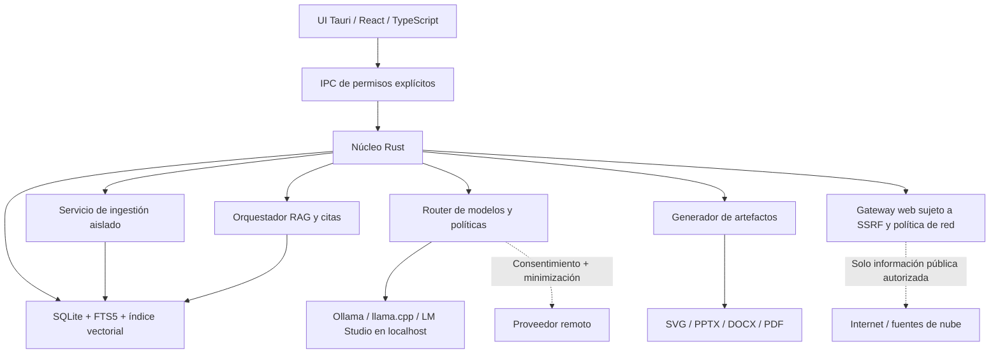

# Resumen ejecutivo

Se propone una **aplicación de escritorio local-first de investigación y estudio asistidos por IA**, inspirada en NotebookLM, renombrado por Google como **Gemini Notebook** en julio de 2026 [S1]. La aplicación administrará notebooks independientes, fuentes locales y remotas, notas editables, conversaciones generales y basadas en fuentes, búsquedas web, resúmenes, informes, guías de estudio y un estudio de creación de presentaciones e infografías. La generación de podcasts, narraciones y vídeo queda fuera de la primera versión.

El atributo distintivo no es simplemente «ejecutar un LLM sin internet»: es establecer **fronteras verificables entre almacenamiento local, consulta externa, inferencia local y envío autorizado a proveedores de IA**. La navegación por páginas web y la lectura de contenido de una nube pueden funcionar sin subir los archivos locales a un modelo remoto; no obstante, la búsqueda web transmite la consulta al buscador y el acceso a una nube comparte los identificadores y solicitudes imprescindibles con ese servicio. Cualquier operación que envíe fragmentos de documentos a una API externa deberá ser excepcional, visible, opt-in y auditable.

**Recomendación técnica:** Tauri 2 + React/TypeScript para escritorio; Rust para permisos, base de datos y orquestación; SQLite con FTS5 y, si supera las pruebas de compatibilidad, sqlite-vec; SQLCipher o cifrado equivalente para la persistencia; Ollama como primer motor local, con adaptadores para llama.cpp, LM Studio y proveedores remotos; Docling/MarkItDown en un proceso aislado para extracción; motor de artefactos basado en datos estructurados editables, SVG y PptxGenJS. El software debe seguir siendo útil sin conexión, tras instalar previamente modelos y descargar fuentes relevantes [S11–S19].

Este documento es una **especificación de referencia para iniciar desarrollo**, no una aplicación implementada. Las capacidades de productos de terceros corresponden a documentación consultada en octubre de 2026; sus APIs, licencias y disponibilidad deberán verificarse antes de integrar versiones concretas.

# 1. Referente: NotebookLM / Gemini Notebook

## 1.1 Qué es y cómo funciona

NotebookLM nació como una herramienta de investigación centrada en **fuentes seleccionadas por el usuario**. En julio de 2026, Google anunció su cambio de nombre a Gemini Notebook, conservando el producto independiente e incorporando integración con su ecosistema y capacidades adicionales de análisis [S1]. Su flujo principal es: crear un cuaderno, cargar o descubrir documentos, seleccionar fuentes, preguntar en chat con citas navegables y transformar el contenido en materiales de aprendizaje o difusión [S2–S5].

El concepto diferenciador es el **grounding**: en vez de presentar una respuesta genérica, el sistema debe mostrar qué pasajes sostienen sus afirmaciones. La documentación de Google advierte expresamente que el contenido generado puede contener errores. Por lo tanto, el producto a desarrollar debe prometer **trazabilidad y mecanismos de verificación**, nunca veracidad infalible [S2, S5].

## 1.2 Funciones confirmadas en la documentación actual

| Categoría | Funcionalidad del referente | Implicación de diseño |
|---|---|---|
| Organización | Cuadernos, fuentes, notas que pueden funcionar como fuentes | Entidades notebook/source/note separadas, con versiones y selección de contexto |
| Importación | Archivos, texto pegado, enlaces web, vídeos públicos con transcripción y servicios del ecosistema | Ingestores por tipo, metadatos de origen, conversión local y conectores autorizados |
| Investigación | Descubrimiento web, búsqueda rápida y profunda | Buscador desacoplado + selección humana antes de importar resultados |
| Conversación | Chat contextual con citas, configuración y capacidades adicionales | Modos «Fuentes», «General» e «Investigación» claramente identificados |
| Estudio | Guías, cuestionarios, tarjetas, mapas conceptuales | Artefactos vinculados a evidencias y exportables |
| Producción | Informes, infografías, presentaciones, tablas y otros documentos | Generación estructurada, revisión, edición y exportación |
| No prioritario | Audio Overview, vídeo y otras experiencias multimodales | Interfaces preparadas para extensiones futuras, sin implementarlas al inicio |

La guía de fuentes detalla restricciones específicas para importación de URLs y vídeos; por ejemplo, en el referente se extrae principalmente texto de páginas HTML y las fuentes de YouTube se basan en transcripciones [S3]. La plataforma propuesta no necesita copiar esas restricciones: debe documentar claramente qué elementos extrae, cuáles omite y cómo los verifica.

## 1.3 Lecciones para la experiencia del usuario

El patrón visual de **fuentes a la izquierda, conversación al centro y estudio/artefactos a la derecha** favorece que el estudiante ubique la evidencia sin perder el contexto. No conviene copiar visualmente marcas ni materiales propietarios de Google: se debe construir una interfaz original con flujos similares, respetando derechos de autor, términos y licencias.

La generación de infografías del referente ofrece parámetros como orientación, idioma, nivel de detalle, estilo e instrucciones de enfoque [S6]. Sus presentaciones admiten objetivos distintos, longitud y exportación; igualmente advierte errores visuales y factuales [S7]. Estos dos módulos requieren **validación de contenido antes del diseño**.

# 2. Alcance y requisitos

## 2.1 Usuarios y escenarios

**Estudiante:** reúne PDFs, apuntes y artículos; recibe explicaciones progresivas; crea guías y autoevaluaciones; conserva una copia local para estudiar sin internet. **Docente:** estructura un tema, genera esquemas, informes y presentaciones revisables, con citas a fuentes. **Investigador:** compara versiones de documentos, distingue contradicciones, obtiene referencias y exporta un informe de trazabilidad. **Usuario general:** mantiene notebooks temáticos y usa un chat de IA convencional al margen de las fuentes.

Se plantea inicialmente una **aplicación de un solo usuario por instalación** en Windows, macOS y Linux. La colaboración multiusuario en tiempo real, sincronización entre dispositivos y publicación pública no forman parte del MVP; añadirlas posteriormente exigirá un modelo de permisos, cifrado y resolución de conflictos distinto.

## 2.2 Requisitos funcionales

- **RF-01.** Crear, renombrar, archivar, etiquetar, buscar, duplicar y eliminar notebooks.
- **RF-02.** Importar PDF, TXT, MD, DOCX, HTML y texto pegado; registrar hash, origen, versión y estado de extracción.
- **RF-03.** Agregar URLs públicas tras revisar dominio, formato y vista previa; guardar una copia textual local para uso sin conexión.
- **RF-04.** Buscar en internet con proveedor configurable; mostrar fuente, dominio, fecha y fragmento; importar sólo lo seleccionado.
- **RF-05.** Crear notas editables; convertir respuestas o notas en fuentes seleccionables sin romper referencias existentes.
- **RF-06.** Chat basado en fuentes, con citas a fragmentos y acceso al documento original; respuesta «no hay evidencia suficiente» si procede.
- **RF-07.** Chat general independiente del notebook, con elección explícita de modelo y sin acceso automático a documentos.
- **RF-08.** Motor de modelos compatible con al menos un backend local y un adaptador remoto opt-in; mostrar destino, datos a enviar y coste estimado cuando exista información suficiente.
- **RF-09.** Resúmenes, fichas de lectura, guías e informes con plantilla, alcance temático, extensión y bibliografía.
- **RF-10.** Generación de infografías de alcance controlado, por secciones editables, con fuentes de cada afirmación y exportación SVG/PNG.
- **RF-11.** Presentaciones con guion, comprobación de hechos, vista previa y exportación PPTX/PDF, sin convertir todo el texto en una sola imagen.
- **RF-12.** Importar contenido de proveedores de nube mediante conectores autorizados; copiar sólo archivos seleccionados a almacenamiento local.
- **RF-13.** Uso offline real: abrir notebook, buscar en fuentes importadas, conversar con modelo local instalado y crear artefactos básicos.
- **RF-14.** Administrar colas de importación y generación, cancelar tareas y reintentar errores sin duplicar archivos.
- **RF-15.** Exportar/importar notebooks en un paquete versionado, con advertencias de secretos, permisos y derechos de autor.

## 2.3 Requisitos no funcionales y objetivos de aceptación

| Área | Objetivo comprobable |
|---|---|
| Privacidad | Sin llamadas a APIs externas ni telemetría por defecto; pruebas de captura de tráfico en modo offline |
| Control remoto | 100 % de envíos de contenidos a modelos remotos requieren decisión autorizada según política; no depender sólo de un popup |
| Integridad | Hash SHA-256 del archivo original y registro de transformaciones; historial de versiones |
| Citas | Cada cita generada apunta a un source_id y a un segmento existente; nunca se inventan identificadores |
| Aislamiento | Cada consulta está restringida al notebook y a las fuentes seleccionadas, validado en base de datos |
| Resiliencia | No perder información confirmada si se interrumpe una extracción o generación |
| Portabilidad | Instaladores probados en Windows, macOS y Linux; documentar divergencias del sistema operativo |
| Accesibilidad | Navegación por teclado, contraste adecuado, contenido semántico y alternativas textuales |
| Rendimiento | Metas definidas mediante benchmark en hardware real, sin prometer tokens/segundo universales |
| Auditabilidad | Registro local de conectores, autorización, versión de fuente y modelo usado, sin volcar datos sensibles |

# 3. Arquitectura del sistema

## 3.1 Componentes y fronteras de confianza



**Regla de seguridad:** ni el renderer ni un documento HTML importado deben tener acceso libre a archivos, red, secretos o comandos del sistema. Tauri proporciona el puente IPC y capacidades, pero su documentación recuerda que los comandos Rust y plugins mantienen privilegios nativos y necesitan validación detallada [S11]. La gestión de solicitudes a localhost también debe tratarse como acceso de red sujeto a política, con excepciones estrictas por destino.

## 3.2 Decisión Tauri frente a Electron

| Criterio | Tauri 2 | Electron |
|---|---|---|
| Núcleo privilegiado | Rust | Node.js / proceso principal |
| Renderer | WebView del sistema | Chromium incluido |
| Peso de distribución | Normalmente menor; depende de plataforma y dependencias | Normalmente mayor, distribución más uniforme de Chromium |
| Seguridad | Capacidades e IPC; requiere defender comandos nativos | Aislamiento de contexto, sandbox, sin Node en contenido remoto |
| Ecosistema | Buen ajuste para lógica nativa segura y sidecars | Amplio ecosistema JS y bibliotecas maduras |
| Complejidad | Rust más curva de aprendizaje; WebView varía por SO | Más homogéneo en frontend; mayor superficie de dependencias |

**Selección:** Tauri 2 para una aplicación local-first con núcleo de seguridad en Rust. **Alternativa válida:** Electron si el equipo depende fuertemente de JS/Node y está preparado para mantener su lista de controles (contextIsolation, sandbox, CSP, navegación restringida, preload mínimo) [S11, S12]. Ningún framework garantiza seguridad por sí mismo.

## 3.3 Procesos y comunicación

El proceso Tauri expone comandos tipados como `create_notebook`, `import_source`, `search_sources`, `answer_question` y `generate_artifact`. Los trabajos largos deben ejecutarse en cola asíncrona, reportar progreso y permitir cancelación. El conversor de documentos se ejecuta como **sidecar restringido** y el servicio de inferencia se administra mediante adaptadores HTTP que, para motores locales, escuchan sólo en `127.0.0.1`; el puerto no se expone a la LAN por defecto [S13].

La UI no debería hacer `fetch()` directo a proveedores externos: así se centralizan consentimiento, redacción de datos, credenciales, rate limits y auditoría. El proceso de generación de presentaciones consume solamente el guion verificado y el conjunto de recursos aprobados.

# 4. Datos, base de datos y archivos

## 4.1 Persistencia recomendada

SQLite es adecuada para una aplicación de escritorio individual porque evita mantener un servidor. `FTS5` indexa términos exactos, mientras que `sqlite-vec` puede almacenar vectores y ejecutar búsquedas de similitud; el proyecto sqlite-vec sigue descrito por su autor como **pre-v1**, por lo que la implementación ha de abstraerlo y fijar una versión probada [S14]. En un escenario de mayor tamaño se puede migrar el índice a Qdrant/LanceDB, pero no conviene incorporar esa complejidad antes de medir.

Para información sensible se recomienda SQLCipher o un mecanismo probado equivalente. **Importante:** cifrar la base de datos no cifra automáticamente archivos originales, miniaturas, cachés, temporales ni modelos. Se necesita un diseño integral de cifrado en reposo, gestión de claves y borrado de temporales [S15].

## 4.2 Modelo conceptual y relaciones

| Tabla | Campos relevantes | Propósito |
|---|---|---|
| `notebooks` | `id`, `title`, `created_at`, `updated_at`, `settings_json` | Espacio temático y política por defecto |
| `sources` | `id`, `notebook_id`, `kind`, `uri`, `sha256`, `classification`, `status` | Documento importado y clasificación |
| `source_versions` | `id`, `source_id`, `revision`, `fetched_at`, `content_hash`, `storage_path` | Instantáneas, actualización y trazabilidad |
| `chunks` | `id`, `source_version_id`, `ordinal`, `text`, `page`, `char_start`, `char_end` | Evidencia localizable |
| `chunk_vectors` | `chunk_id`, `model_id`, `dimension`, `vector` | Representación semántica y versión de embedding |
| `notes` | `id`, `notebook_id`, `title`, `body`, `revision` | Texto propio editable |
| `chats` / `messages` | `id`, `notebook_id` opcional, `mode`, `role`, `body`, `model_id` | Historial de chat contextual o general |
| `citations` | `message_id`, `chunk_id`, `quote`, `offsets`, `verification_status` | Enlace entre afirmación y prueba |
| `artifacts` | `id`, `notebook_id`, `type`, `spec_json`, `status`, `revision` | Infografías, informes y presentaciones |
| `jobs` | `id`, `type`, `state`, `progress`, `error_code` | Tareas en segundo plano |
| `connectors` | `id`, `provider`, `scopes_json`, `policy_json` | Configuración sin secretos en claro |
| `audit_events` | `action`, `destination`, `policy_decision`, `timestamp` | Rastro de operaciones sensibles |

Conviene aplicar claves foráneas, índices por notebook, borrado por cascada deliberado y transacciones. Un `source_version_id` inmutable evita que una cita histórica cambie silenciosamente cuando se actualiza una página. Las notas que se indexan como fuentes deben generar una versión y reconstruir sólo sus segmentos afectados.

## 4.3 Ejemplo SQL inicial

```sql
PRAGMA foreign_keys = ON;
CREATE TABLE notebooks (
  id TEXT PRIMARY KEY,
  title TEXT NOT NULL,
  created_at TEXT NOT NULL,
  updated_at TEXT NOT NULL
);
CREATE TABLE sources (
  id TEXT PRIMARY KEY,
  notebook_id TEXT NOT NULL REFERENCES notebooks(id) ON DELETE CASCADE,
  kind TEXT NOT NULL,
  uri TEXT,
  sha256 TEXT NOT NULL,
  classification TEXT NOT NULL DEFAULT 'private',
  status TEXT NOT NULL
);
CREATE TABLE source_versions (
  id TEXT PRIMARY KEY,
  source_id TEXT NOT NULL REFERENCES sources(id) ON DELETE CASCADE,
  revision INTEGER NOT NULL,
  fetched_at TEXT NOT NULL,
  storage_path TEXT NOT NULL,
  UNIQUE(source_id, revision)
);
CREATE TABLE chunks (
  id INTEGER PRIMARY KEY,
  source_version_id TEXT NOT NULL REFERENCES source_versions(id),
  ordinal INTEGER NOT NULL,
  page INTEGER,
  text TEXT NOT NULL,
  char_start INTEGER,
  char_end INTEGER
);
CREATE VIRTUAL TABLE chunks_fts USING fts5(
  text, content='chunks', content_rowid='id'
);
-- Mantener chunks_fts sincronizada mediante triggers de INSERT/UPDATE/DELETE
-- o por una rutina transaccional explícita de reconstrucción.
```

Este código es un **esqueleto de esquema**, no una migración completa de producción: todavía faltan triggers, gestión de claves, índices complementarios, control de revisión y migraciones.

# 5. Ingesta y recuperación fundamentada (RAG)

## 5.1 Pipeline de importación

1. Identificar y validar el tipo MIME real; comprobar tamaño máximo, firma del archivo y permisos.
2. Calcular el hash del archivo original y registrar fecha, procedencia, URI y licencia conocida.
3. Procesar en una zona aislada: PDF, DOCX, PPTX, HTML, imágenes y texto, según capacidad del parser.
4. Conservar estructura: páginas, encabezados, tablas, pies, citas textuales y referencias de ubicación.
5. Normalizar texto sin destruir citas, fórmulas ni números; deduplicar y segmentar respetando párrafos.
6. Generar embeddings localmente; guardar identificador, versión y dimensión del modelo de embedding.
7. Crear índice de palabras y vectorial, ejecutar controles de calidad y marcar la fuente como `ready`.

**Opciones de extracción:** Docling proporciona tratamiento avanzado de documentos y tablas; MarkItDown es una alternativa ligera para convertir diversos archivos a texto/Markdown [S16, S17]. Ningún parser garantiza por sí solo reconstrucción perfecta de PDFs escaneados; incluir OCR local opcional con indicador de confianza y revisión de páginas conflictivas.

## 5.2 Recuperación híbrida y respuestas verificables

**Búsqueda híbrida**: buscar coincidencias léxicas con FTS5/BM25 y semánticas mediante embeddings; combinar resultados mediante Reciprocal Rank Fusion u otra estrategia validada; reordenar candidatos si existe un reranker local apropiado. No permitir que un vector de otro modelo se compare silenciosamente con una dimensión incompatible. Ollama documenta embeddings para RAG y recuerda usar el mismo modelo al indexar y consultar [S18].

El sistema debe generar una respuesta desde un **paquete de evidencia**: pregunta, fragmentos relevantes, títulos, IDs internos, ubicación y límites de contexto. Se pueden sintetizar conclusiones a partir de varios textos, pero se requiere diferenciar:

- **Respaldado:** afirmación con pasaje verificable.
- **Inferencia:** interpretación derivada de hechos citados.
- **Discrepancia:** fuentes que se contradicen y sus fechas.
- **No comprobado:** información insuficiente, obsoleta o no corroborada.

Una cita válida no demuestra que la fuente sea verdadera. La verificación exige contrastar autoría, fecha, entidad editora, metodología, versión, fuente primaria y, cuando corresponda, otra fuente independiente. Los resúmenes deben incluir una sección «Limitaciones y dudas» cuando haya incertidumbre; no inventar referencias para completar una respuesta.

## 5.3 Evaluación de calidad RAG

Construir un conjunto de evaluación con preguntas y respuestas humanas sobre 10–20 documentos de distintos formatos, incluyendo preguntas imposibles, conflictos entre fuentes, documentos en español y notas modificadas. Medir `citation_precision`, `citation_recall`, coincidencia de hechos soportados, respuestas justificadas de abstención y latencia. Las puntuaciones automáticas son auxiliares: una evaluación humana deberá revisar alucinaciones y precisión de las citas.

# 6. IA local, enrutamiento y proveedores

## 6.1 Qué significa IA local

Un modelo local ejecuta la **inferencia en el equipo**, con pesos y runtime descargados. Puede funcionar sin red y evita enviar el prompt al operador de una API remota, pero sigue siendo necesario proteger el disco, los procesos, el acceso al servidor local y los registros. «Local» no significa intrínsecamente «seguro» ni «correcto». La cuantización reduce el tamaño en memoria, con posibles compromisos de calidad; llama.cpp documenta soporte GGUF y aceleración según hardware [S19].

Casos de uso principales: explicación de notas privadas, tarjetas de repaso, búsqueda en documentos internos, esquemas y resúmenes, clasificación, extracción estructurada, análisis comparativo y generación de guiones. Las tareas de gran contexto, visión y gráficos avanzados pueden requerir modelos mayores, VRAM adicional o proveedores opcionales.

## 6.2 Selección dinámica, sin bloqueo por proveedor

Implementar la interfaz `ModelAdapter` para descubrir capacidades y ejecutar solicitudes. El router debe decidir por **política y capacidad**, no por la aparente inteligencia del modelo: `chat`, `embedding`, `json_schema`, `vision`, `image_generation`, `context_window`, `offline_available`, `estimated_cost`. Se recomienda no codificar IDs comerciales que cambian con frecuencia. La disponibilidad y condiciones del endpoint remoto se validan al configurar la conexión [S18, S20].

| Modo | Uso | Restricción |
|---|---|---|
| Local privado | Inferencia exclusivamente en el equipo | Sin proveedor remoto, sin fallback automático |
| Híbrido consultivo | Traer páginas públicas por internet y responder con modelo local | Sólo consultas/descargas web explícitas; no datos privados en buscador |
| Híbrido con proveedor | Usar API externa para solicitud concreta | Vista previa de información enviada y consentimiento |
| Offline estricto | Sin conectividad externa | Sólo contenido y pesos ya disponibles; se bloquean jobs de red |

**Regla crítica:** si un modelo local falla, el sistema **no** debe cambiar automáticamente a una API remota. La configuración `cloud_fallback=false` ha de ser la predeterminada y debe cumplirse en el backend, no sólo en la UI.

## 6.3 Conectores en nube

Un conector (por ejemplo, Drive, OneDrive o Dropbox) es un **lector de archivos remotos**, no un proveedor de inferencia. Debe usar OAuth con navegador del sistema, PKCE cuando corresponda, scopes mínimos, tokens guardados en keychain y descarga de archivos elegidos. El dato llega al repositorio local y se procesa con embeddings y LLM locales por defecto. No subir copias locales de forma inversa salvo acción independiente autorizada.

Los conectores deben almacenar estado de sincronización, `etag` o versión, conflictos y fecha de última actualización. El usuario debe poder revocar el acceso, eliminar tokens y borrar las copias locales. También deben respetarse límites de API, permisos del propietario y derechos del contenido.

# 7. Infografías: de una pregunta a una explicación progresiva

Este módulo es esencial para el proyecto. La solicitud del usuario puede ser «Crea una infografía sobre el ciclo del agua, desde evaporación hasta infiltración, para estudiantes de secundaria». En lugar de pedirle a un modelo «haz una imagen con todo», hay que **descomponer la intención en una estructura que pueda revisarse**.

## 7.1 Proceso propuesto

1. **Intención y alcance:** tema, punto inicial, punto final, audiencia, idioma, profundidad, tamaño y estilo.
2. **Guion pedagógico:** identificar conceptos, prerequisitos y relaciones; ordenar secciones en una secuencia comprensible.
3. **Recolección de evidencia:** resolver cada sección frente a fuentes del notebook y marcar afirmaciones sin respaldo.
4. **Especificación estructurada:** construir JSON tipado para títulos, nodos, cifras, explicaciones, flechas, citas y recursos gráficos.
5. **Composición:** renderizar a SVG/HTML/CSS mediante plantillas y diagramación algorítmica; opcionalmente solicitar ilustraciones a un motor de imágenes local o externo autorizado.
6. **Vista previa por secciones:** el usuario abre, amplía y edita un paso, pide mayor detalle o cambia la profundidad antes de finalizar.
7. **Validación:** comprobar textos, fuentes, relaciones, escalas, no solapamiento y legibilidad; exportar SVG/PNG/PDF.

## 7.2 Ejemplo de especificación JSON

```json
{
  "type": "infographic",
  "title": "El ciclo del agua",
  "audience": "secundaria",
  "scope": { "from": "evaporación", "to": "infiltración" },
  "layout": "vertical-steps",
  "sections": [
    {
      "id": "paso-1",
      "heading": "Evaporación",
      "explanation": "El agua líquida pasa a vapor por aporte de energía.",
      "evidence": [{ "chunk_id": 174, "quote": "..." }],
      "visual": { "kind": "process-icon", "name": "sun-water" }
    }
  ],
  "review_status": "pending"
}
```

El backend no debe confiar en el `chunk_id` generado por el LLM: lo valida contra la evidencia real y comprueba que el segmento citado pertenezca a las fuentes autorizadas. El placeholder `...` representa un texto que se sustituye exclusivamente por una cita recuperada y verificable.

## 7.3 Por qué SVG estructurado antes que difusión de imágenes

El render estructurado mantiene textos editables y citas enlazables, permite corregir errores sin rehacer el diseño y normalmente exige menos recursos de GPU. Los modelos de imagen locales (por ejemplo, motores basados en Diffusers) son una mejora opcional para **ilustraciones decorativas**, no para dibujar por sí solos tablas, flechas o etiquetas exactas [S21]. Si se usa un proveedor remoto para gráficos, enviarle sólo un brief anonimizado o datos públicos aprobados; las fuentes privadas no se adjuntan por defecto.

# 8. Presentaciones, informes y herramientas de estudio

## 8.1 Generación de presentaciones

La cadena recomendada es: **brief → esquema de diapositivas → selección de evidencia → texto y gráficos → validación → exportación**. Cada diapositiva necesita objetivo comunicativo, título, puntos clave, nivel de detalle, referencias, recursos y notas del ponente opcionales. El render puede usar plantillas y PptxGenJS para obtener elementos editables en PowerPoint [S22]. Exportar PPTX es distinto de generar PNGs de páginas; la edición exige guardar la estructura original de texto, formas, imágenes y gráficos.

Permitir modos «presentación visual» y «documento para lectura» con diferente densidad de contenido. Antes de exportar, un validador debe revisar que ninguna afirmación sustantiva carezca de fuente cuando se haya elegido el modo «basado en fuentes». También revisar desbordes, contraste, títulos, imágenes y derechos de autor.

## 8.2 Informes y resúmenes

Un informe debe configurarse mediante una plantilla (informe técnico, resumen de estudio, comparación crítica, preguntas frecuentes o guía) y parámetros de extensión, público, estructura y fuentes incluidas. Se genera primero un outline con referencias, después cada sección, y finalmente un pase de coherencia y validación cruzada. El resultado se almacena como artefacto **versionado**, exportable a Markdown, DOCX o PDF. Para una explicación paso a paso de estudio, incorporar controles «ampliar», «explicar con ejemplo», «comparar» y «preguntarme» por sección.

## 8.3 Preparación para ejercicios interactivos

Tarjetas, cuestionarios y mapas conceptuales están documentados en Gemini Notebook [S8, S9]. En este proyecto deben derivar de los mismos `chunks` y `evidence` que alimentan el chat. Una tarjeta necesita reverso explicativo, fuente, dificultad y registro de repaso; un cuestionario necesita distractores revisados y explicación de la opción correcta. La repetición espaciada puede añadirse sin requerir proveedor remoto.

# 9. Seguridad por diseño

## 9.1 Modelo de amenazas mínimo

| Amenaza | Riesgo | Control mínimo |
|---|---|---|
| Prompt injection en web/PDF | El contenido intenta ordenar al modelo que ignore políticas o filtre secretos | Fuentes como datos no confiables, políticas independientes del LLM, herramientas restringidas [S23] |
| RAG poisoning | Fragmentos maliciosos alteran respuestas o citas | Control de procedencia, versiones, evaluación de reputación, revisión de citas [S24] |
| SSRF en importador URL | Solicitudes a localhost, LAN, metadata o rutas reservadas | Validación por destino y conexión, bloquear redes privadas, redirects, DNS rebinding [S25] |
| Filtración a APIs de IA | Envío accidental de apuntes privados | Egress broker, opt-in por tarea, vista previa de payload, bloqueo predeterminado |
| Plugin o sidecar comprometido | Acceso a disco/red con privilegios | Firma, hashes, sandbox, permisos mínimos, dependencia fijada |
| HTML/PDF malicioso | XSS o explotación de parser | No ejecutar JS en HTML importado; parsers aislados; sanitización y limites |
| Secretos en la aplicación | Robo de tokens o credenciales | Keychain del SO, nunca guardar claves sin cifrar en SQLite ni en logs |
| Exposición de puerto local | Otro proceso o sitio accede a endpoint | Bind loopback; autenticación/CSRF/origin cuando corresponda; no escuchar `0.0.0.0` |
| Pérdida de datos | Corrupción de DB o sobrescritura | WAL/backup consistente, migraciones reversibles, snapshots cifrados |
| Respuesta falsa con citas | Confianza indebida en contenidos erróneos | Comprobación cita-afirmación, contraste de fuentes y abstención |

## 9.2 Política de clasificación y salida

Clasificar cada fuente como `public`, `internal`, `private` o `restricted`. En MVP puede bastar `public/private`, pero conviene diseñar el tipo desde el principio. Un router nunca debe interpretar «usar modelo X» como autorización para revelar todo el notebook: calcula un conjunto de fragmentos concretos permitidos y presenta destino + tamaño + categorías de datos. Los secretos detectados se ocultan y, para datos sensibles, se exige confirmación explícita y no persistente.

Ejemplo de política: `PRIVATE + LOCAL_LLM = permitir`; `PRIVATE + WEB_SEARCH = bloquear contenido privado en consulta`; `PRIVATE + REMOTE_LLM = bloquear salvo autorización de esa solicitud`; `RESTRICTED + REMOTE_LLM = denegar siempre según configuración`; `PUBLIC + WEB_SEARCH = permitir con los controles de red`. La opción offline estricto debe cortar toda salida (incluidos análisis, telemetría, actualizaciones y búsqueda de modelos), validado con firewall y captura de tráfico.

## 9.3 Protección del importador web

Aceptar una URL del usuario hace necesario analizar protocolo, host, dirección resuelta, puerto, redirecciones, longitud y tipo de respuesta. No basta con bloquear cadenas `localhost`: hay IPv6, DNS rebinding, codificaciones y redirecciones. Realizar validación en cada conexión efectiva y mantener controles también dentro de contenedores o sidecars [S25]. Restringir esquemas a HTTPS y excepciones definidas, tamaño de descarga, tiempo máximo, profundidad y contenido aceptado. El documento remoto nunca debe poder solicitar lectura de rutas `file://` o acceso al keychain.

## 9.4 Gobierno de dependencias, licencias y privacidad

Inventariar componentes con SBOM, revisar licencias de código, modelos y datasets, fijar versiones, firmar paquetes, comprobar hashes de modelos, aislar conversores y planificar actualizaciones. Para modelos descargables, la licencia de pesos y la de uso comercial pueden diferir. El proveedor de búsqueda también puede registrar consultas; hay que comunicarlo. Establecer transparencia sobre qué se guarda, cómo se elimina y qué puede ver cada proveedor externo.

# 10. Referentes de código abierto y reutilización

| Proyecto | Qué estudiar o reutilizar | Advertencia de integración |
|---|---|---|
| **Open WebUI** | UI de chat, conocimiento, RAG híbrido, proveedores de búsqueda [S26] | Su arquitectura puede ser más amplia que una app monousuario |
| **AnythingLLM** | Aplicación local, workspaces, conexión documental y política de privacidad [S27] | Revisar licencia exacta y código usado; no adoptar promesas de privacidad sin pruebas |
| **PrivateGPT** | API de ingesta, RAG con citas y adaptadores para servidores locales [S28] | Su enfoque backend puede requerir un proceso separado |
| **Docling** | Extracción estructural de PDF y tablas [S16] | Coste de dependencias/modelos de OCR; sandbox obligatorio |
| **MarkItDown** | Normalización a Markdown de diversos formatos [S17] | La conversión no preserva necesariamente toda la estructura visual |
| **Ollama / llama.cpp** | Runtime local, chat, embeddings, JSON y modelos GGUF [S18–S19] | Compatibilidad de modelo, hardware y licencias |
| **sqlite-vec** | Similitud vectorial dentro de SQLite [S14] | API pre-v1; fijar versión y encapsular |
| **PptxGenJS** | PPTX editable con elementos de texto, formas y tablas [S22] | QA de solapamiento y compatibilidad con LibreOffice/PowerPoint |

Se recomienda **aprender los patrones y reutilizar bibliotecas con licencia compatible**, no incorporar grandes repositorios enteros antes de comprender sus superficies de ataque. La separación del producto en módulos permite reemplazar cada implementación sin alterar los contratos internos.

# 11. Ejemplos prácticos de integración

## 11.1 Chat local con Ollama (TypeScript)

El siguiente es un ejemplo del **adaptador de backend**, no código para ejecutarse directamente en el renderer. Requiere Ollama iniciado localmente y un modelo que exista en el equipo. La política de permisos y clasificación debe evaluarse antes de invocar la función [S18].

```ts
type Message = { role: "system" | "user" | "assistant"; content: string };

export async function chatLocal(
  model: string,
  messages: Message[],
  signal?: AbortSignal,
): Promise<string> {
  const response = await fetch("http://127.0.0.1:11434/api/chat", {
    method: "POST",
    headers: { "Content-Type": "application/json" },
    body: JSON.stringify({ model, messages, stream: false }),
    signal,
  });
  if (!response.ok) throw new Error(`Local LLM HTTP ${response.status}`);
  const json = await response.json();
  if (typeof json?.message?.content !== "string") {
    throw new Error("Invalid local LLM response");
  }
  return json.message.content;
}
```

## 11.2 Embeddings locales con Ollama (Python)

```python
import requests

def embed_local(texts: list[str], model: str = "embeddinggemma") -> list[list[float]]:
    response = requests.post(
        "http://127.0.0.1:11434/api/embed",
        json={"model": model, "input": texts}, timeout=120,
    )
    response.raise_for_status()
    vectors = response.json()["embeddings"]
    if len(vectors) != len(texts):
        raise ValueError("Embedding count mismatch")
    if vectors and any(len(v) != len(vectors[0]) for v in vectors):
        raise ValueError("Embedding dimension mismatch")
    return vectors
```

En producción, la llamada pasa por un servicio controlado; se valida modelo instalado, límite de lotes, tamaño y almacenamiento de revisión. La implementación final debe usar la biblioteca estándar de Rust u otro lenguaje del proceso privilegiado, si se busca evitar mantener Python para una tarea tan simple.

## 11.3 Selección de evidencia y aislamiento de notebook (SQL)

```sql
SELECT c.id, c.text, c.page, sv.id AS source_version_id
FROM chunks c
JOIN source_versions sv ON sv.id = c.source_version_id
JOIN sources s ON s.id = sv.source_id
WHERE s.notebook_id = :notebook_id
  AND s.id IN (SELECT value FROM json_each(:selected_source_ids))
  AND s.status = 'ready'
  AND c.id = :candidate_chunk_id;
```

El `selected_source_ids` viene de una selección previamente validada por el núcleo. Antes de citar un pasaje, la aplicación ejecuta una comprobación equivalente y verifica el texto/offset real. La consulta no constituye por sí sola la recuperación híbrida: es un **filtro de autorización y validación de cita** que debe aplicarse también a los candidatos FTS y vectoriales.

## 11.4 Política de egress (pseudocódigo)

```text
function authorize_request(task, payload, model, workspace_policy):
    destination = registry.resolve_and_validate(model)
    if workspace_policy.offline_strict and destination.is_network:
        DENY("offline mode")
    if destination.is_remote_model:
        if not workspace_policy.allow_remote_models:
            DENY("remote inference disabled")
        data = minimize_to_approved_chunks(payload)
        if contains_restricted_data(data):
            DENY("restricted source")
        require_explicit_user_approval(destination, data, task.id)
        return ALLOW_WITH_SCOPE(data, task.id)
    if destination.is_public_web:
        require_web_policy_check(payload.query)
        return ALLOW_WITH_SCOPE(payload.public_query_only, task.id)
    return ALLOW_LOCAL(task.id)
```

**No delegar la decisión a un LLM**. Debe ser código determinista, con pruebas unitarias y de seguridad; los motores de IA sólo proponen acciones que el núcleo valida.

## 11.5 Generación básica de PPTX editable (JavaScript)

```js
import pptxgen from "pptxgenjs";

export async function exportSlides(verifiedSlides, fileName) {
  const pptx = new pptxgen();
  pptx.layout = "LAYOUT_WIDE";
  for (const item of verifiedSlides) {
    const slide = pptx.addSlide();
    slide.addText(item.title, { x: 0.6, y: 0.4, w: 11.8, h: 0.8,
      fontSize: 28, bold: true, color: "243247" });
    slide.addText(item.body, { x: 0.7, y: 1.6, w: 11.8, h: 4.5,
      fontSize: 19, breakLine: false, color: "243247" });
    // Insertar fuentes verificadas y gráfico/s según la plantilla.
  }
  await pptx.writeFile({ fileName });
}
```

Este ejemplo es deliberadamente mínimo; faltan estilos dinámicos, medición de desbordes, notas de ponente y exportación PDF. El input `verifiedSlides` es una estructura que ya pasó controles de evidencia y política [S22].

# 12. Estructura sugerida del repositorio y contratos

```text
apps/desktop/              # Tauri 2 y frontend React
apps/desktop/src/          # UI: notebooks, sources, chat, studio, settings
apps/desktop/src-tauri/    # Núcleo Rust, comandos y capabilities
crates/core-domain/        # Entidades, clasificación, policies, errores
crates/storage/            # SQLite, cifrado, migraciones, archivos
crates/retrieval/          # FTS, vectores, ranking, citas
crates/ai-router/          # Adaptadores y autorización de inferencia
crates/connectors/         # Web, OAuth y proveedores de archivos
workers/documents/         # Ingesta aislada (Docling/MarkItDown)
packages/artifacts/        # Esquemas JSON, infografías SVG, PPTX
packages/contracts/        # Esquemas JSON y tipos compartidos
security/                  # Threat model, tests SSRF y egress
benchmarks/                # Corpus, evaluaciones y hardware
```

Los comandos de IPC deben devolver errores tipados, versionarse de forma compatible, y nunca aceptar rutas de sistema arbitrarias sin verificación y confinamiento. En configuración de Tauri declarar expresamente qué ventanas y capacidades se habilitan. Los adaptadores de proveedores deben soportar timeout, cancelación, límites de contexto, idempotencia cuando aplique y gestión de errores de red. Para seguridad, registrar metadatos de autorización, no el texto íntegro de prompts sensibles.

**Contrato conceptual de generación:**

```json
{
  "notebook_id": "nb-123",
  "artifact_type": "infographic",
  "prompt": "Explicar desde el concepto A hasta el concepto D",
  "source_ids": ["src-1", "src-2"],
  "output": { "language": "es", "format": "svg", "detail": "expanded" },
  "model_preference": { "mode": "local_only", "id": "installed-model-id" }
}
```

El contrato no debe aceptar una propiedad como `skip_security_checks`; las autorizaciones se derivan de política y sesión confiable. Nunca guardar credenciales del proveedor dentro de la especificación de un artefacto.

# 13. Plan de desarrollo y entregables

Las duraciones son **estimaciones de planificación, no presupuestos**. Varían según equipo, experiencia en Rust, hardware, revisiones de seguridad y calidad de la generación.

| Fase | Entregable principal | Duración orientativa |
|---|---|---|
| 0. Descubrimiento | PRD, amenazas, benchmark de hardware, decisiones de licencia, prototipo de UX | 1–2 semanas |
| 1. Núcleo local | Tauri, notebooks, SQLite, importación básica, chat con modelo local | 3–5 semanas |
| 2. RAG robusto | Extracción mejorada, embeddings, búsqueda híbrida, citas clicables, pruebas | 4–6 semanas |
| 3. Híbrido seguro | Navegador web, importación URLs, permisos, proveedor remoto, conector piloto | 3–5 semanas |
| 4. Estudio y documentos | Notas, resúmenes, informes, guías, exportación y versionado | 3–4 semanas |
| 5. Estudio visual | Infografías SVG editables y generador de presentaciones PPTX | 5–8 semanas |
| 6. Endurecimiento | QA multiplataforma, pruebas offline, privacidad, empaquetado y piloto | 3–5 semanas |

Las fases pueden solaparse parcialmente. Un **MVP útil de notebook local con RAG, citas y fuentes web** podría estimarse en 8–14 semanas por un equipo experimentado pequeño; una versión v1 con infografías, presentaciones y endurecimiento puede necesitar 5–8 meses o más. No son compromisos de entrega ni sustituyen estimación por historias de usuario.

## 13.1 Criterios de salida por fase

La fase 1 se acepta cuando un usuario crea un notebook, importa un PDF textual, elige un modelo local, hace preguntas y puede reabrir toda la sesión sin internet. La fase 2 exige que cada cita abra exactamente el fragmento citado y que no se referencien fuentes de otro notebook. La fase 3 exige que una solicitud de IA externa no se ejecute sin autorización y que las URLs privadas/loopback se bloqueen bajo pruebas adversariales. La fase 4 requiere exportaciones legibles y versionadas. La fase 5 exige editar pasos de una infografía sin regenerarla completa y producir PPTX con texto editable. La fase 6 requiere una auditoría de flujos de red y un piloto con documentos difíciles y fallas simuladas.

# 14. Hardware, costes y riesgos técnicos

## 14.1 Perfiles aproximados

| Equipo | Capacidad esperable | Consideración |
|---|---|---|
| 8 GB RAM, CPU | Modelos muy pequeños cuantizados, búsqueda y resumen lento | No prometer buen rendimiento con documentos extensos |
| 16 GB RAM | Modelos locales pequeños/medianos cuantizados, RAG documental | Recomendación mínima práctica para una experiencia razonable, sujeto a pruebas |
| 32 GB RAM y GPU o memoria unificada adecuada | Mejor multitarea, modelos más capaces y operaciones simultáneas | Recomendado para desarrolladores y usuarios intensivos |
| GPU dedicada con VRAM suficiente | Generación de ilustraciones locales más viable | La memoria necesaria depende del modelo y la resolución; medir antes de fijar un mínimo |

La cuantización puede reducir memoria de pesos, pero el contexto, el KV cache, los embeddings y los procesos de documentos también consumen RAM. Se debe permitir limitar longitud de contexto, concurrencia y número de chunks. Los modelos y OCR suelen requerir descarga previa: el primer uso «sin internet» sólo será posible si esos recursos ya existen.

## 14.2 Costes y dependencias externas

El uso local evita pagos por tokens al proveedor de IA, pero no elimina costes de energía, almacenamiento, descarga de modelos, mantenimiento ni GPU. Las búsquedas web y APIs remotas pueden tener tarifas, términos y límites. El proyecto debe registrar costos estimados sólo cuando el proveedor y las condiciones del plan permitan calcularlos; no fijar una tabla de precios sin obtener valores actuales de las fuentes oficiales.

## 14.3 Riesgos prioritarios

1. **Alcance excesivo:** intentar paridad total con Gemini Notebook desde el primer sprint impide entregar una aplicación estable.
2. **Promesas absolutas de privacidad y verdad:** no existen si se admiten conectores remotos, bugs y fuentes erróneas; sustituirlas por controles y evidencias verificables.
3. **Parser poco confiable:** pierde tablas, encabezados y ubicación; produciría citas engañosas aunque el modelo responda bien.
4. **Multiplataforma real:** distintas WebViews, permisos, empaquetado y soporte GPU pueden crear fallos no visibles en el equipo de desarrollo.
5. **Infografías como imagen única:** imposibilita edición fiable y corrección de textos; mantener representación estructurada como fuente de verdad.
6. **Dependencia de servicios cambiantes:** usar adaptadores con pruebas de contrato, feature flags y versiones fijadas.

# 15. Pruebas adversariales y aceptación del producto

Preparar una batería repetible con al menos estos escenarios: (a) un PDF contiene instrucciones para «ignorar al usuario»; se trata como datos; (b) una página importada incluye una URL a `127.0.0.1`, a red privada o redirige allí; la descarga se deniega; (c) el modelo local está caído; no aparece tráfico a una API externa; (d) un usuario selecciona un PDF privado y un modelo remoto; la autorización debe mostrar el contenido concreto o bloquear; (e) dos notebooks contienen conceptos idénticos con datos incompatibles; el sistema mantiene el aislamiento; (f) una fuente cambia de versión; las citas históricas apuntan a la revisión original; (g) el buscador devuelve desinformación; la síntesis muestra procedencia, fechas y discrepancias; (h) un PDF escaneado omite una cifra por OCR; se marca la incertidumbre y facilita la revisión; (i) un PPTX genera desbordes; los tests detectan el defecto; (j) una infografía tiene número o fórmula errónea; es posible editarla sin perder su evidencia.

Los umbrales cuantitativos de precisión y latencia deberán derivarse del conjunto de evaluación y del hardware objetivo. No se deben inventar métricas de calidad. El **gate de privacidad** sí es binario: ningún envío a API externa sin decisión de autorización. El **gate de fuentes** también debe ser binario a nivel referencial: ninguna cita apunta a un ID inexistente o a fuente no autorizada.

# 16. Decisiones abiertas y recomendación final

Antes de crear tickets de desarrollo conviene decidir: plataformas prioritarias (Windows primero o simultáneo), idioma inicial (español recomendado), modelo local de referencia y perfiles mínimos, nivel de cifrado obligatorio, conectores de nube prioritarios, compatibilidad de licencias, y si las infografías en la primera versión serán sólo SVG editable o también ilustraciones con modelos generativos. Estas decisiones condicionan el tamaño de los instaladores y el coste de mantenimiento.

La ruta recomendada es construir primero **un Notebook basado en fuentes realmente fiable, offline y local**, luego incorporar descubrimiento web y conectores con una capa de permisos, y finalmente usar el mismo motor de evidencia para informes, infografías y presentaciones. El valor sostenible del producto estará en la continuidad entre estudio, evidencia, privacidad y creación, no en sumar opciones visuales sin una arquitectura que garantice su coherencia.

# Fuentes y referencias técnicas verificadas

Las referencias se citan con identificadores `[S#]` en el texto. Se priorizan documentación oficial, manuales de seguridad y repositorios mantenidos por sus autores. Fecha de investigación: **15 de octubre de 2026**.

[S1] Google, *NotebookLM is now Gemini Notebook* (16 jul. 2026). https://blog.google/innovation-and-ai/products/gemini-notebook/notebooklm-gemini-notebook/

[S2] Google Help, *Use chat in Gemini Notebook*. https://support.google.com/gemininotebook/answer/16179559?hl=en

[S3] Google Help, *Add or discover new sources for your notebook*. https://support.google.com/gemininotebook/answer/16215270?hl=en

[S4] Google Help, *Create & add notes in Gemini Notebook*. https://support.google.com/gemininotebook/answer/16262519?hl=en

[S5] Google, *Do better research with NotebookLM* (jun. 2026). https://blog.google/innovation-and-ai/products/notebooklm/better-research-notebooklm/

[S6] Google Help, *Generate an Infographic in Gemini Notebook*. https://support.google.com/gemininotebook/answer/16758265?hl=en

[S7] Google Help, *Generate a Slide Deck in Gemini Notebook*. https://support.google.com/gemininotebook/answer/16757456?hl=en

[S8] Google Help, *Generate Flashcards or Quizzes in Gemini Notebook*. https://support.google.com/gemininotebook/answer/16958963?hl=en

[S9] Google Help, *Use Mind Maps in Gemini Notebook*. https://support.google.com/gemininotebook/answer/16212283?hl=en

[S10] Google Help, *Generate reports in Gemini Notebook*. https://support.google.com/gemininotebook/answer/18323649?hl=en

[S11] Tauri, *Security and Capabilities*. https://v2.tauri.app/security/ ; https://v2.tauri.app/security/capabilities/

[S12] Electron, *Security*. https://www.electronjs.org/docs/latest/tutorial/security/

[S13] Tauri, *Embedding External Binaries*. https://v2.tauri.app/develop/sidecar/

[S14] sqlite-vec, *Repository and API reference*. https://github.com/asg017/sqlite-vec

[S15] Zetetic, *SQLCipher*. https://www.zetetic.net/sqlcipher/ ; https://www.zetetic.net/sqlcipher/design/

[S16] Docling, *Official repository*. https://github.com/docling-project/docling

[S17] Microsoft, *MarkItDown converters*. https://github.com/microsoft/markitdown

[S18] Ollama, *Chat API, Embeddings and Structured Outputs*. https://docs.ollama.com/api/chat ; https://docs.ollama.com/capabilities/embeddings ; https://docs.ollama.com/capabilities/structured-outputs

[S19] llama.cpp, *README / GGUF*. https://github.com/ggml-org/llama.cpp

[S20] LM Studio, *OpenAI Compatibility Endpoints*. https://lmstudio.ai/docs/developer/openai-compat

[S21] Hugging Face, *Diffusers text-to-image pipelines*. https://huggingface.co/docs/diffusers/api/pipelines/stable_diffusion/text2img

[S22] PptxGenJS, *Official repository*. https://github.com/gitbrent/PptxGenJS

[S23] OWASP, *LLM Prompt Injection Prevention Cheat Sheet*. https://cheatsheetseries.owasp.org/cheatsheets/LLM_Prompt_Injection_Prevention_Cheat_Sheet.html

[S24] OWASP, *RAG Security Cheat Sheet*. https://cheatsheetseries.owasp.org/cheatsheets/RAG_Security_Cheat_Sheet.html

[S25] OWASP, *Server Side Request Forgery Prevention Cheat Sheet*. https://cheatsheetseries.owasp.org/cheatsheets/Server_Side_Request_Forgery_Prevention_Cheat_Sheet.html

[S26] Open WebUI, *Repository and RAG features*. https://github.com/open-webui/open-webui ; https://github.com/open-webui/docs/blob/main/docs/features/chat-conversations/rag/index.md

[S27] AnythingLLM, *Desktop privacy and self-hosted terms*. https://github.com/Mintplex-Labs/anythingllm-docs/blob/main/pages/installation-desktop/privacy.mdx ; https://github.com/Mintplex-Labs/anything-llm/blob/master/TERMS_SELF_HOSTED.md

[S28] PrivateGPT, *Official repository*. https://github.com/zylon-ai/private-gpt
