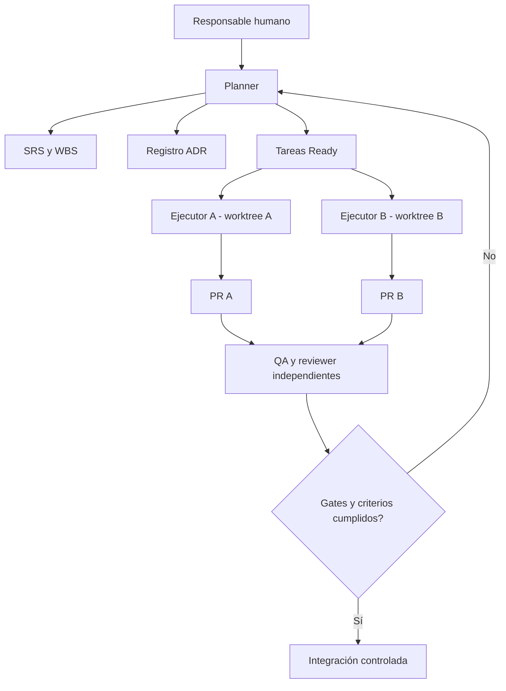

# Arquitectura — dos planos separados

**Estado:** arquitectura del producto **sin decidir**; arquitectura organizativa del desarrollo descrita y sujeta a ADRs.

## Plano A. Desarrollo agéntico

`planner` centraliza tareas y estado; `architect` y `security` asesoran; cada `implementer` posee rama/worktree aislado; `qa` y `reviewer` inspeccionan entregas; PRs/Git constituyen el rastro auditable. Los agentes son actores del **proceso** y no necesariamente componentes de SanctumLM.

**Contratos:** cada tarea tiene `task-id` inmutable y enlace a requisitos; cada ADR tiene número y estado; el estado durable se versiona; el estado efímero compartido se mantiene fuera de los worktrees. Detalles operativos en [modelo de agentes](../05-agents/OPERATING_MODEL.md).

## Plano B. Producto SanctumLM

Arquitectura pendiente de G0/G1. No hay decisión aprobada sobre frontend, backend, modelo de lenguaje, proveedores, bases de datos, servicios, CLI, MCP, ejecución local/nube, redes ni librerías. El nombre del repositorio no prueba ninguna de esas características.

En G1 documentar al menos:
- Contexto C4 nivel 1: usuarios/sistemas externos y límites de confianza.
- Contenedores C4 nivel 2: módulos, responsabilidades y protocolos.
- Modelo de datos y flujos de información, retención y clasificación.
- Modelo de amenazas, mecanismos de identidad/autorización y fallos seguros.
- Decisiones ADR, trade-offs, plan de observabilidad, pruebas y despliegue.
- Matriz requisito → componente → prueba.

## Principios mientras se descubre el producto

Preferir cortes verticales pequeños, contratos explícitos, fallos seguros, pruebas repetibles y mínimos permisos. Evitar decidir stack «por costumbre» y evitar infraestructura compleja sin requisitos que la justifiquen.

El PR que apruebe G1 debe reemplazar esta sección pendiente con una arquitectura sustentada, no con afirmaciones especulativas.
