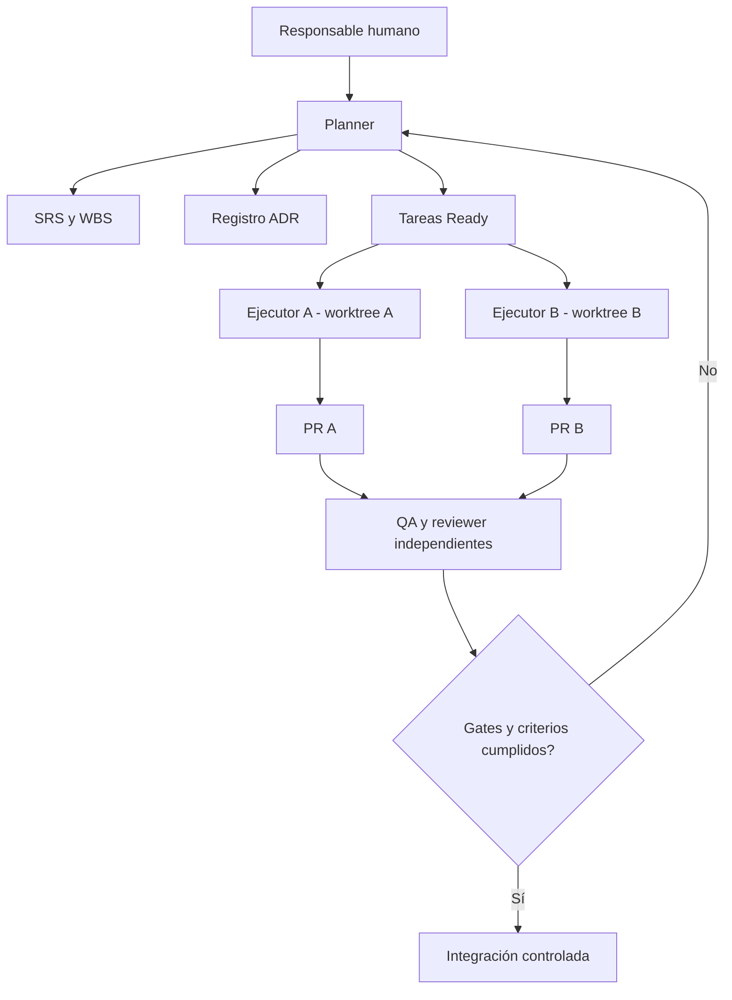
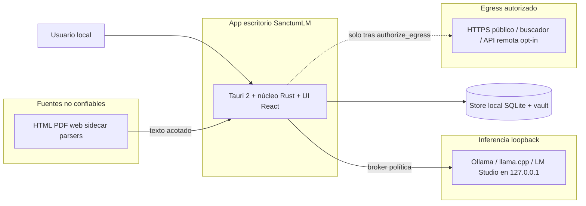
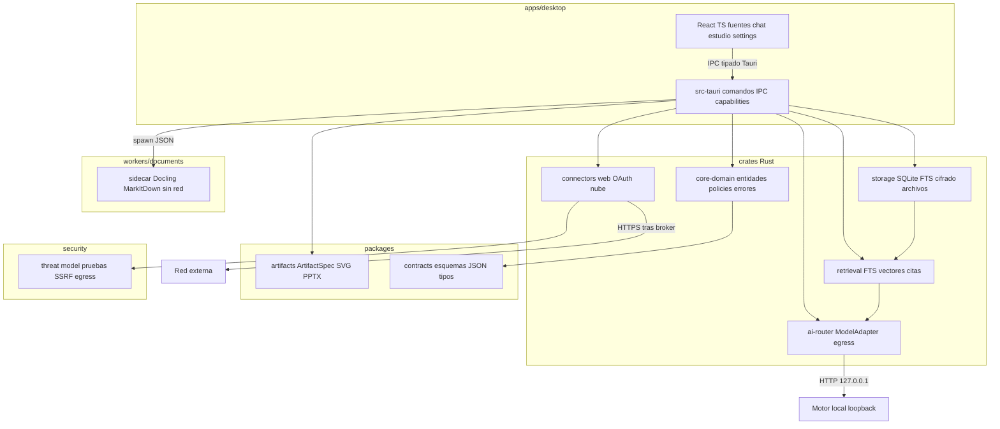

# Arquitectura — dos planos separados

**Estado:** Plano A (desarrollo agéntico) operativo. Plano B (producto) **propuesto en G1** — síntesis TASK-0015; **aprobación humana de PARADA 1 pendiente**. Consume ADR-0006–0011 en estado `proposed` sin marcarlos `accepted`.

## Plano A. Desarrollo agéntico

`planner` centraliza tareas y estado; `architect` y `security` asesoran; cada `implementer` posee rama/worktree aislado; `qa` y `reviewer` inspeccionan entregas; PRs/Git constituyen el rastro auditable. Los agentes son actores del **proceso** y no necesariamente componentes de SanctumLM.

**Contratos:** cada tarea tiene `task-id` inmutable y enlace a requisitos; cada ADR tiene número y estado; el estado durable se versiona; el estado efímero compartido se mantiene fuera de los worktrees. Detalles operativos en [modelo de agentes](../05-agents/OPERATING_MODEL.md).

## Plano B. Producto SanctumLM (C4 G1)

Vista consolidada para PARADA 1. Decisiones detalladas: [ADR-0006](adr/ADR-0006-desktop-stack.md) (stack), [ADR-0007](adr/ADR-0007-storage.md) (persistencia), [ADR-0008](adr/ADR-0008-model-router.md) (inferencia), [ADR-0009](adr/ADR-0009-ingestion.md) (ingesta), [ADR-0010](adr/ADR-0010-artifact-engine.md) (artefactos), [ADR-0011](adr/ADR-0011-threat-model-egress.md) (egress). Amenazas: [THREAT_MODEL.md](THREAT_MODEL.md). Contratos IPC/dominio: [DATA_AND_INTERFACES.md](DATA_AND_INTERFACES.md). Pruebas: [TEST_PLAN.md](../04-quality/TEST_PLAN.md) (`TC-PROD-*`).

### B.1 Contexto C4 — nivel 1

Actores y sistemas en el límite de confianza del producto (investigación §3.1, ADR-0011):

| Elemento | Rol | Confianza |
| --- | --- | --- |
| Usuario | Opera notebooks, autoriza envíos remotos puntuales | Alta |
| App escritorio | Orquestación, políticas, IPC, colas | Alta (núcleo Rust) |
| Store local | Metadatos, FTS, vectores, blobs versionados | Alta; renderer sin rutas arbitrarias |
| Inferencia loopback | Chat y embeddings locales | Destino de red acotado a `127.0.0.1` |
| Egress autorizado | Web pública, modelos remotos, conectores | Solo vía broker determinista en Rust |
| Fuentes no confiables | Importados y sidecars | Tratados como datos; nunca instrucciones de sistema |

### B.2 Contenedores C4 — nivel 2

Layout objetivo OLA 2 (investigación §12, [ADR-0006](adr/ADR-0006-desktop-stack.md)); **no materializado** en el repositorio hasta tareas post-G1.

**Protocolos entre contenedores**

| Origen | Destino | Protocolo | Notas |
| --- | --- | --- | --- |
| UI renderer | Núcleo `src-tauri` | Comandos IPC Tauri tipados y versionados | Sin `fetch` a red/IA desde el WebView |
| Núcleo | Sidecar ingesta | STDIO/IPC acotado, JSON de extracción | Sidecar sin red ni keychain |
| Núcleo | SQLite/vault | SQL transaccional + archivos | WAL, aislamiento por `notebook_id` |
| Núcleo | Motores locales | HTTP(S) solo a `127.0.0.1` | Puertos registrados por adaptador |
| Núcleo | Internet/API | Cliente HTTP en broker Rust | Tras `authorize_egress`; ver ADR-0011 |
| Motor artefactos | PptxGenJS / render SVG | Invocación en proceso controlado o worker | Entrada solo `ArtifactSpec` validado |

### B.3 Invariantes de producto (implementación)

Obligatorios cuando el código exista; derivan de ADR-0006–0011 y R-PROD-101/102/111.

| ID | Invariante |
| --- | --- |
| INV-01 | El renderer **no** abre sockets ni `fetch` hacia proveedores externos ni motores de IA; toda salida pasa por IPC al núcleo. |
| INV-02 | **EgressPolicy** en Rust es determinista; el LLM **no** concede permisos de red ni clasificación. |
| INV-03 | `cloud_fallback=false` en backend: fallo del modelo local **no** dispara envío automático a remoto. |
| INV-04 | Motores locales asumidos en **`127.0.0.1`**; prohibido `0.0.0.0` / exposición LAN por defecto. |
| INV-05 | Secretos (OAuth, API) **solo** keychain del SO; nunca en SQLite, `ArtifactSpec`, logs ni `audit_events` completos. |
| INV-06 | Citas: el backend valida `chunk_id` / `source_version_id` contra BD y selección autorizada; ignora IDs del LLM no verificados. |
| INV-07 | Recuperación (FTS y vectorial) filtra por `notebook_id` y `selected_source_ids` validados en el núcleo. |
| INV-08 | Chat general (`R-PROD-007`): el router **no** invoca RAG ni embeddings de notebooks. |
| INV-09 | Fuentes importadas: sin ejecución de JS HTML; parsers en sidecar sin egress autónomo. |
| INV-10 | Jobs largos: cola con progreso, cancelación e idempotencia; no duplicar fuentes confirmadas al reintentar. |
| INV-11 | `ArtifactSpec` y contratos de generación **rechazan** `skip_security_checks` y campos de credenciales. |

### B.4 Hipótesis de cierre (no resuelven OPEN-*)

Propuestas para revisión humana en PARADA 1; las cuestiones siguen **abiertas** en [OPEN_QUESTIONS.md](../00-project/OPEN_QUESTIONS.md).

**OPEN-005 — proveedores, buscador y conectores (hipótesis):** en desarrollo y CI del MVP, los proveedores reales (buscador comercial, APIs de pago, OAuth de nube) se sustituyen por **fakes HTTP locales** o stubs registrados; los contratos (`ModelAdapter`, gateway web, conector piloto) se validan contra esos fakes. La elección de marcas, formatos y versiones concretas queda para decisión humana; la investigación §6 y §10 listan candidatos, no compromisos.

**OPEN-006 — clasificación y retención (hipótesis):** operar en MVP con **`public` | `private`** en UI y políticas; reservar en esquema los niveles **`internal` | `restricted`** para evolución sin migración breaking. Cifrado en reposo según propuesta [ADR-0007](adr/ADR-0007-storage.md) **pendiente de** [`OPEN-010`](../00-project/OPEN_QUESTIONS.md) (nivel obligatorio y gestión de claves); no implementar persistencia `private` en builds de usuario hasta cierre de OPEN-010 + evidencia SQLCipher/FTS/sqlite-vec.

**OPEN-007 — UX, idioma y accesibilidad (hipótesis):** layout de tres columnas **fuentes | chat | estudio** en **español** como idioma inicial del MVP; cumplir navegación por teclado y contraste en flujos principales (`R-PROD-108`). Segundo idioma (p. ej. inglés) **no** exigido en MVP; preparar cadenas/externalización sin bloquear el vertical slice.

**OPEN-008 — modelo local y hardware (hipótesis):** **Ollama en loopback** como primer backend ([ADR-0008](adr/ADR-0008-model-router.md)); perfil mínimo práctico **16 GB RAM** (investigación §14.1). Modelo de referencia único para KPIs: **sin ratificar** — spike de modelos documentado como `not-run` hasta benchmark en hardware real (`RSK-12`).

### B.5 Trazabilidad diseño (requisito → contenedor → prueba)

Matriz detallada de componentes en [TRACEABILITY.md](../01-requirements/TRACEABILITY.md). Resumen para G1:

| Requisito (muestra) | Contenedor principal | Prueba diseño |
| --- | --- | --- |
| R-PROD-001, 002, 014 | `storage`, `workers/documents`, cola jobs | TC-PROD-001, 002, 014 |
| R-PROD-006, 104, 105 | `retrieval`, validador citas en núcleo | TC-PROD-006, 104, 105 |
| R-PROD-003, 004, 102 | `connectors`, egress broker | TC-PROD-003, 004, 102 |
| R-PROD-008, 007 | `ai-router` | TC-PROD-008, 007 |
| R-PROD-009–011, 015 | `packages/artifacts`, núcleo | TC-PROD-009–011, 015 |
| R-PROD-101, 111 | egress + sidecars + políticas | TC-PROD-101, 111 |
| R-PROD-108, 109 | UI + benchmarks | TC-PROD-108, 109 |

Cada `R-PROD-001..015` y `R-PROD-101..111` tiene un `TC-PROD-###` homólogo en [TEST_PLAN.md](../04-quality/TEST_PLAN.md).

### B.6 Observabilidad, despliegue y pruebas (diseño)

- **Observabilidad local:** `audit_events` con metadatos de decisión de política, destino y modelo; sin volcar prompts íntegros ni secretos (`R-PROD-110`).
- **Despliegue:** instalador Tauri por SO; orden de plataformas sujeto a `OPEN-009`; empaquetado no iniciado en este repositorio.
- **Pruebas:** capa estática documental (`validate_docs.py`); batería adversarial §15 como criterio de aceptación futuro ([THREAT_MODEL.md §5](THREAT_MODEL.md)); suite `TC-PROD-*` definida, ejecución **not-run** hasta implementación.

## Principios mientras se descubre el producto

Preferir cortes verticales pequeños, contratos explícitos, fallos seguros, pruebas repetibles y mínimos permisos. Evitar decidir stack «por costumbre» y evitar infraestructura compleja sin requisitos que la justifiquen.

La aprobación humana de G1 convierte esta propuesta en línea base de implementación; hasta entonces ningún ADR de producto pasa a `accepted` por síntesis documental sola.
