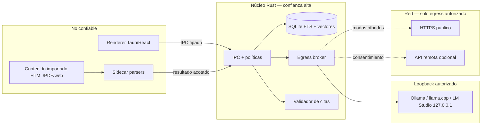

# Modelo de amenazas — producto SanctumLM

**Estado:** propuesto (G1)  
**Fecha:** 2026-10-16  
**Tarea:** TASK-0014  
**Decisión vinculada:** [ADR-0011](adr/ADR-0011-threat-model-egress.md) (`proposed`)  
**Requisitos:** R-PROD-003, R-PROD-101, R-PROD-102, R-PROD-104, R-PROD-105, R-PROD-110, R-PROD-111

Este documento describe amenazas, controles y evidencias de aceptación para el MVP. No sustituye el proceso agéntico en [SECURITY.md](../04-quality/SECURITY.md). La implementación concreta queda para tareas de desarrollo posteriores a la aprobación de G1.

## 1. Fronteras, activos y actores

### 1.1 Diagrama de confianza (resumen)



### 1.2 Activos

| Activo | Descripción | Impacto si se compromete |
| --- | --- | --- |
| A1 Notebooks y fuentes | Texto, metadatos, clasificación | Fuga de apuntes privados |
| A2 Chunks y versiones | Evidencia RAG y citas | Citas falsas o mezcla entre notebooks |
| A3 Embeddings | Vectores por chunk/modelo | Inferencia sobre datos ajenos |
| A4 Credenciales | OAuth/API en keychain | Acceso a nube del usuario |
| A5 Audit trail | `audit_events` | Pérdida de accountability o filtración vía logs |
| A6 Copias URL | `source_version` offline | Contenido malicioso persistente (contenido, no red) |

### 1.3 Actores y motivaciones

| Actor | Capacidad | Objetivo típico |
| --- | --- | --- |
| Usuario legítimo | UI, importación, políticas | Productividad con privacidad |
| Contenido adversarial | Texto en PDF/HTML/web | Prompt injection, exfil vía modelo |
| Atacante de red local | Otros procesos en el equipo | Abusar de puertos mal enlazados |
| Atacante SSRF | URL o redirección maliciosa | Escanear LAN/metadata |
| Proveedor remoto | Recibe payload autorizado | Registro, retención, inferencia |
| Sidecar comprometido | Parser con bug RCE | Escalar a disco/red |

### 1.4 Fronteras explícitas

1. **Almacenamiento local:** solo el núcleo accede a SQLite y rutas de almacenamiento con permisos mínimos; el renderer no recibe rutas arbitrarias del SO.
2. **Inferencia loopback:** tráfico a motores locales es «red» sujeta a política, con allowlist de `127.0.0.1` y puertos registrados por adaptador.
3. **Egress autorizado:** toda salida a Internet o API remota pasa por el broker Rust ([ADR-0011](adr/ADR-0011-threat-model-egress.md)).
4. **Fuentes no confiables:** nunca ejecutan código ni emiten comandos IPC; se normalizan a texto/estructura en sidecar aislado.

## 2. Catálogo de amenazas (investigación §9.1 ampliado)

| ID | Amenaza | Riesgo | Control mínimo | Reqs. |
| --- | --- | --- | --- | --- |
| T1 | Prompt injection en web/PDF | Modelo obedece al documento | Separación instrucción/datos; políticas fuera del LLM; herramientas restringidas | R-PROD-111 |
| T2 | RAG poisoning | Respuestas sesgadas o citas maliciosas | Procedencia, versiones, validación de citas en BD | R-PROD-104, R-PROD-111 |
| T3 | SSRF en importador URL | Acceso LAN/metadata | Validación por conexión; bloqueo loopback/privado/metadata; límites redirect | R-PROD-003 |
| T4 | Filtración a API de IA | Exfil de apuntes | Egress broker; opt-in; minimización; default offline | R-PROD-101, R-PROD-102 |
| T5 | Sidecar/plugin comprometido | Disco/red ampliados | Sandbox, permisos mínimos, hashes, sin secretos | R-PROD-111 |
| T6 | HTML/PDF malicioso | XSS o exploit de parser | Sin JS en HTML importado; parsers aislados; límites tamaño/tiempo | R-PROD-111 |
| T7 | Secretos en app | Robo de tokens | Keychain SO únicamente | R-PROD-111 |
| T8 | Exposición puerto local | Acceso cruzado desde web | Bind loopback; auth/origin en endpoints expuestos | R-PROD-111 |
| T9 | Pérdida/corrupción datos | Pérdida de estudio | WAL, transacciones, versiones inmutables | R-PROD-105 (aislamiento lógico) |
| T10 | Citas falsas | Confianza indebida | Comprobación chunk + versión + fuentes autorizadas | R-PROD-104 |
| T11 | Fallback cloud encubierto | Tráfico no autorizado | `cloud_fallback=false` en backend | R-PROD-101, R-PROD-102 |
| T12 | Mezcla entre notebooks | Fuga entre contextos | Filtro SQL por `notebook_id` y selección validada | R-PROD-105 |

## 3. Política de clasificación y egress

### 3.1 Clasificación (propuesta `OPEN-006`)

Ver [ADR-0011 §9](adr/ADR-0011-threat-model-egress.md#9-propuesta-para-open-006-no-cierra-la-cuestión). En MVP operar con **`public` | `private`**; reservar **`internal` | `restricted`** en esquema para políticas más finas sin cerrar [`OPEN-006`](../00-project/OPEN_QUESTIONS.md).

Principios (investigación §9.2):

- El router **no** interpreta frases del usuario o del modelo como autorización global.
- Calcula el conjunto de **fragmentos concretos** permitidos para la operación.
- Presenta destino, tamaño agregado y categorías antes de envío remoto.
- Secretos detectados por heurística: redacción; datos sensibles: confirmación explícita **no persistente**.

### 3.2 Cuatro modos de egress

| Modo | ID interno sugerido | Red | Datos notebook |
| --- | --- | --- | --- |
| Local privado | `egress_local` | Solo loopback LLM/embeddings | Según clasificación; sin Internet |
| Híbrido consultivo | `egress_web_public` | HTTPS a URL/buscador aprobado | Solo consulta pública; sin chunks privados |
| Híbrido con proveedor | `egress_remote_model` | API remota configurada | Minimización + aprobación por tarea |
| Offline estricto | `egress_none` | Ninguna | Solo local |

Flujo lógico del broker (investigación §11.4, implementación Rust):

```text
authorize_egress(task, payload, destination, notebook_policy) -> Decision
  if notebook_policy.offline_strict && destination.uses_network():
      return DENY("offline_strict")
  if destination.is_remote_model():
      if !notebook_policy.allow_remote_models: return DENY
      data = minimize_to_approved_chunks(payload)
      if contains_restricted(data): return DENY
      return REQUIRE_USER_APPROVAL(destination, data, task.id)
  if destination.is_public_web():
      if payload.contains_private_chunks: return DENY
      return ALLOW_WITH_SCOPE(public_query_only, task.id)
  if destination.is_local_loopback():
      return ALLOW_LOCAL(task.id)
  return DENY("unknown_destination")
```

**Invariante:** ninguna rama llama al LLM para decidir. Tests adversariales deben poder falsificar cada rama ([R-PROD-102](../01-requirements/SRS.md)).

### 3.3 `cloud_fallback=false`

| Evento | Comportamiento requerido |
| --- | --- |
| Error HTTP loopback | Fallo visible; **sin** reintento remoto automático |
| Timeout inferencia local | Cancelar job; **sin** sustitución de modelo remoto |
| Modelo local no instalado | Bloquear tarea; ofrecer acción manual (descarga/config), no egress |

Evidencia de diseño para escenario **(c)** §15: captura de tráfico sin conexiones a APIs externas.

## 4. Controles SSRF e importación web (§9.3)

### 4.1 Pipeline de importación URL ([R-PROD-003](../01-requirements/SRS.md))

1. Usuario revisa dominio, formato y vista previa (UI).
2. Núcleo valida URL sintáctica y política notebook (`egress_web_public` o importación dedicada).
3. Resolución DNS controlada; rechazo si IP en blocklist **antes** de conectar.
4. Conexión HTTPS con revalidación de IP en **cada** salto de redirección (máx. N).
5. Descarga acotada → normalización en sidecar → `source` + `source_version` + chunks.
6. Lecturas posteriores usan copia local; **sin** red.

### 4.2 Blocklist de destinos (no exhaustiva)

| Categoría | Ejemplos | Acción |
| --- | --- | --- |
| Loopback | `127.0.0.0/8`, `::1`, `localhost` | DENY |
| Privada RFC1918 | `10/8`, `172.16/12`, `192.168/16` | DENY |
| Link-local | `169.254/16`, `fe80::/10` | DENY |
| Metadata cloud | `169.254.169.254`, IMDS equivalentes | DENY |
| CGNAT | `100.64.0.0/10` | DENY |
| Esquemas | `file`, `gopher`, `ftp` (salvo excepción futura) | DENY |

Controles adicionales: límite de tamaño, timeout total, profundidad redirect, tipos MIME permitidos, rechazo de credenciales embebidas en URL.

### 4.3 Escenario §15 (b)

Página importada enlaza o redirige a `127.0.0.1` o red privada → **descarga denegada**, evento de auditoría `ssrf_blocked` sin URL completa si contiene tokens (truncar/host solo).

## 5. Batería adversarial (investigación §15)

Diseño de aceptación: cada fila define escenario, control arquitectónico, evidencia esperada y requisitos. La implementación de tests queda fuera de TASK-0014.

| Esc. | Escenario | Control | Evidencia esperada | R-PROD |
| --- | --- | --- | --- | --- |
| **(a)** | PDF con «ignora al usuario» | Fuente = datos; system prompt fijo en núcleo; sin herramientas libres | Respuesta no ejecuta instrucción del PDF; T1 mitigado en evaluación | R-PROD-111 |
| **(b)** | URL/redirección a loopback o LAN | SSRF §4 | Import fallido; sin socket a destino interno; audit | R-PROD-003 |
| **(c)** | Modelo local caído | `cloud_fallback=false` | Cero tráfico API externa; error UI | R-PROD-101, R-PROD-102 |
| **(d)** | PDF privado + modelo remoto | Broker + aprobación | Vista previa de payload o DENY; audit sin cuerpo completo | R-PROD-102, R-PROD-110 |
| **(e)** | Dos notebooks, datos incompatibles | SQL `notebook_id` + selección fuentes | Respuesta A no contiene chunks de B | R-PROD-105 |
| **(f)** | Fuente actualizada | `source_version_id` inmutable en citas | Cita histórica apunta revisión original | R-PROD-104, R-PROD-110 |
| **(g)** | Buscador devuelve desinformación | UI síntesis con procedencia/fechas | Muestra fuentes web y discrepancias | R-PROD-110 (trazabilidad) |
| **(h)** | OCR omite cifra | Marcado incertidumbre | Flag revisión humana / baja confianza | R-PROD-111 (parser) |
| **(i)** | PPTX desbordes | Validación layout pre-export | Test detecta overflow antes de entregar | Artefactos (fase 2; trazado WBS) |
| **(j)** | Infografía con error numérico | SVG/estructura editable + enlace evidencia | Edición corrige número sin perder `chunk_id` | R-PROD-104 |

**Gates binarios (CHARTER / §15):**

- **Privacidad:** ningún envío a API externa sin decisión de autorización registrada.
- **Fuentes:** ninguna cita apunta a ID inexistente o fuente no autorizada en el notebook.

## 6. Citas y aislamiento (investigación §11.3)

Consulta de autorización (conceptual):

```sql
SELECT c.id, c.text, c.page, sv.id AS source_version_id
FROM chunks c
JOIN source_versions sv ON sv.id = c.source_version_id
JOIN sources s ON s.id = sv.source_id
WHERE s.notebook_id = :notebook_id
  AND s.id IN (SELECT value FROM json_each(:selected_source_ids))
  AND s.status = 'ready'
  AND c.id = :candidate_chunk_id;
```

Reglas:

- `selected_source_ids` lo fija el núcleo tras acción UI validada, no el LLM.
- Candidatos FTS/vectoriales pasan el mismo filtro antes de entrar al prompt.
- Respuesta final solo incluye citas cuya verificación textual/offset coincide.

## 7. Parsers, sidecars y motores locales

| Control | Detalle |
| --- | --- |
| Aislamiento | Sidecar sin red; límites CPU/memoria/tiempo; IPC con tipos estrictos |
| HTML | Sin motor JS; strip scripts/iframes peligrosos; CSP en renderer |
| PDF | Parser en proceso separado; actualizaciones de dependencia vía SBOM (§9.4) |
| Motores IA | URL base `http://127.0.0.1:<puerto>`; no escuchar en LAN |
| Renderer | Sin `fetch` a remotos; sin acceso keychain |

## 8. Auditoría y privacidad de logs ([R-PROD-110](../01-requirements/SRS.md))

Campos permitidos (ejemplo): `timestamp`, `action`, `destination_kind`, `policy_decision`, `task_id`, `model_id`, `chunk_count`, `classification_summary`, `source_version_id` (UUID), `error_code`.

Campos prohibidos o redactados: tokens, API keys, cuerpo completo de mensajes `private`, texto íntegro de chunks, prompts completos.

Tras escenarios §15: revisión manual o automatizada de que **(d)** y **(c)** no dejan fugas en audit.

## 9. Dependencias y gobierno (§9.4)

Inventario SBOM, licencias de modelos, hashes de pesos, sidecars versionados. Proveedores de búsqueda/remotos: transparencia al usuario sobre registro de consultas (copy/UI; detalle en OPEN-005).

## 10. Trazabilidad y siguientes pasos

| Entrega | Estado |
| --- | --- |
| ADR-0011 | `proposed` — aprobación G1 pendiente |
| THREAT_MODEL (este doc) | Propuesto |
| Implementación broker + gateway | Tarea futura post-G1 |
| `TC-SEC-*` / KPI-1 | QA — fuera de TASK-0014 |
| Cierre `OPEN-006` | Requiere decisión humana; ver ADR-0011 §9 |

**Referencias:** [investigación §9–§11.4, §15](../00-project/research/INVESTIGACION_NOTEBOOK_IA_LOCAL_HIBRIDO.md), [SRS §5](../01-requirements/SRS.md), [CHARTER KPI-1](../00-project/CHARTER.md).
