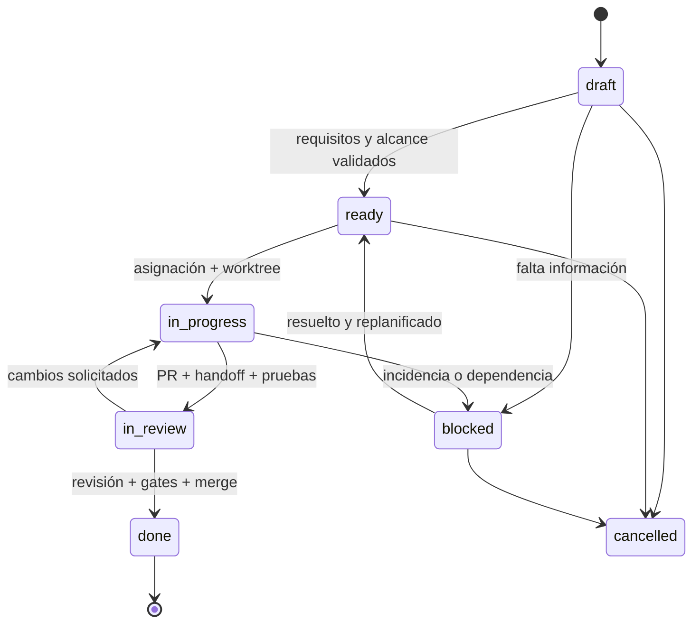

# Modelo operativo de desarrollo multiagente

## 1. Principio rector

El trabajo se descompone en **tareas pequeñas, verificables y aisladas**. El planner controla el plan y actúa como único reconciliador de fuentes canónicas. Agentes especialistas trabajan dentro de la delegación; sus opiniones no son aprobaciones del propietario.

## 2. Roles y separación de funciones

| Rol | Responsabilidad | No puede |
| --- | --- | --- |
| Human owner / PO | Confirmar visión, requisitos, costos, accesos, G0-G4 y aceptar producto | Delegar tácitamente acciones irreversibles |
| Planner | SRS/WBS/backlog, prioridades, dependencias, asignaciones, conflictos, estado y gates | Inventar visión, autoaprobar decisión de alto impacto |
| Architect | Diagramas, contratos y ADRs con alternativas | Imponer stack sin G1 |
| Implementer | Código/documentos y tests en su worktree/task | Tocar otros worktrees o fusionar sin revisión |
| QA | Plan de pruebas, casos negativos, evidencia y aceptación técnica | Declarar pass sin ejecución |
| Reviewer | Revisión independiente, coherencia y riesgos | Ser único aprobador de su propio cambio |
| Security | Amenazas, límites de herramienta, secretos y permisos | Convertir una revisión en autorización externa |

Una instancia de IA puede cambiar de rol **entre tareas**, no dentro de un circuito en el que se autoevalúe. Reviewer y executor de un PR han de ser independientes.

## 3. Ciclo de vida

Estados en el plan son **snapshots**: la información viva de PR/CI puede cambiar hasta que el planner registre la transición. Toda transición comunica timestamp, autor y evidencia.

## 4. Política de planificación y delegación

1. Traducir solicitud en evidencia, requisitos y tareas; marcar hipótesis.
2. Identificar dependencias y contratos comunes. Un archivo o interfaz disputados tienen dueño temporal.
3. Confirmar `Ready` y permisos. Registrar límite de tiempo, contexto y tokens/costo si se autoriza medirlos; una tarea puede suspenderse conservando checkpoint.
4. Entregar ficha al implementer y asignar worktree único.
5. Al abrir PR, asignar reviewer/QA independiente.
6. Aceptación técnica solo con tests, ADR, SRS/WBS, seguridad y aprobación aplicable.
7. Integrar de forma secuencial las tareas que afecten interfaces compartidas; registrar handoff final.

## 5. Política de autonomía y escalación

Agentes pueden leer, analizar, editar sus archivos permitidos, ejecutar pruebas seguras y abrir propuestas. Necesitan permiso explícito para desplegar, publicar, borrar datos, cambiar accesos/licencias, exponer información o gastar. Ante instrucción contradictoria, se aplica la jerarquía [documental](../README.md) y se escala.

La prioridad es corrección verificable, no cantidad de cambios. Nunca declarar `done` por generar un diff.

## 6. Artefactos de cada agregación

Ficha de tarea, rama/worktree, commits, pruebas, actualizaciones documentales, ADR cuando aplique, PR, revisión, handoff y asiento de cierre. Si un cambio no requiere ADR, justificar «ninguna decisión estructural nueva».

## 7. Recuperación ante fallos

El planner consulta estado Git/PR/CI y últimos checkpoints; evita ejecutar dos veces una operación no idempotente. Si el agente se desconecta, reasigna desde un commit conocido a un worktree nuevo, no edita manualmente el worktree del agente caído. Toda recuperación mantiene vínculo al task anterior y evidencia de cancelación.
